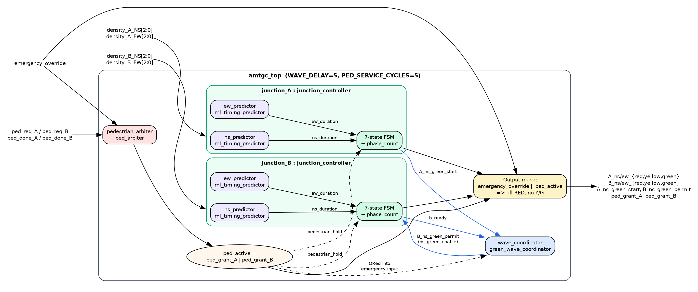
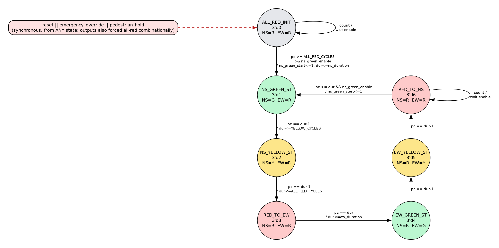

# AMTGC

## AI-Based Adaptive Multi-Junction Traffic Grid Controller

[]()
[]()
[]()

AMTGC is a Verilog RTL traffic-signal controller for two connected four-way junctions. It combines:

- a decision-tree timing predictor that sizes each green from traffic density,
- FSM-based junction controllers,
- green-wave coordination from Junction A to Junction B,
- fair pedestrian-request arbitration, and
- an emergency override that forces all-red.

It is a simulation-verified RTL design exercise. It is **not** a synthesised, hardware-tested or safety-certified traffic controller.

📄 **Technical report:** [`docs/AMTGC_Technical_Report.pdf`](docs/AMTGC_Technical_Report.pdf) (source: [`docs/AMTGC_Technical_Report.md`](docs/AMTGC_Technical_Report.md))

---

## Objectives

1. Sequence NS/EW green → yellow → all-red phases per junction without ever showing conflicting greens.
2. Select green duration (5 / 8 / 12 cycles) from 3-bit density inputs using a decision tree.
3. Release Junction B's NS green a fixed offset (`WAVE_DELAY`) after Junction A's NS green starts.
4. Serve pedestrian requests from both junctions one at a time, with alternating priority.
5. Force both junctions to all-red, and suppress pedestrian grants, on `emergency_override`.
6. Verify each block and the integrated system in ModelSim.

## Architecture

<p align="center">
  
</p>

`amtgc_top` instantiates two `junction_controller`s (each containing two `ml_timing_predictor`s), one `green_wave_coordinator` and one `ped_arbiter`. While `emergency_override` or any pedestrian grant is active, the top level forces every lamp red and holds both FSMs in `ALL_RED_INIT`. The diagram above is generated from the RTL (`docs/figures/*.dot`). The earlier conceptual drawing remains in `screenshots/system_architecture.png`.

<p align="center">
  
</p>

## Modules

| Module                     | File                             | Responsibility                                                                                         |
| -------------------------- | -------------------------------- | ------------------------------------------------------------------------------------------------------ |
| `amtgc_top`              | `rtl/amtgc_top.v`              | Integration; emergency/pedestrian output masking                                                       |
| `junction_controller`    | `rtl/junction_controller.v`    | 7-state phase FSM, phase counter, `ns_green_start` and `b_ready`                                   |
| `ml_timing_predictor`    | `rtl/ml_timing_predictor.v`    | Combinational decision tree: density → SHORT 5 / MEDIUM 8 / LONG 12 cycles                            |
| `green_wave_coordinator` | `rtl/green_wave_coordinator.v` | Counts `WAVE_DELAY − 3` cycles after A's start, then issues a one-cycle permit to B when B is ready |
| `ped_arbiter`            | `rtl/ped_arbiter.v`            | Edge-detected, latched requests; `IDLE` / `SERVING_A` / `SERVING_B`; alternating priority        |
| `generic_timer`          | `rtl/generic_timer.v`          | Reusable start/done timer (unit-tested; **not instantiated** in `amtgc_top`)                   |

The decision tree is recorded in `ml/decision_tree_rules.txt`, and the RTL implements it exactly. Against `ml/traffic_training_data.csv` (4 096 rows), it agrees on **95.31 %** of rows. The three disagreeing (NS, EW) cells are listed in report §4.1.

## Repository structure

```text
AMTGC/
├── README.md
├── rtl/                       Verilog design (6 modules)
├── testbench/                 11 testbenches, plus README.md, an empty ml_timing_predictor_tb.v, and *.bak copies
├── ml/                        decision_tree_rules.txt, traffic_training_data.csv
├── screenshots/               ModelSim captures and diagrams (see docs/SCREENSHOT_CHECKLIST.md)
├── docs/
│   ├── AMTGC_Technical_Report.pdf / .md / .html   technical report + editable source
│   ├── build_report.py         rebuilds the PDF from the .md
│   ├── figures/                FSM and architecture diagrams (Graphviz sources + SVG/PNG)
│   ├── BUG_LOG.md
│   ├── ASSUMPTIONS.md
│   ├── SELF_ATTESTATION_CHECKLIST.md
│   ├── SCREENSHOT_CHECKLIST.md
│   ├── DEMO_VIDEO_SCRIPT.md
│   └── SUBMISSION_AUDIT.md
├── scripts/
│   ├── run_all.do              ModelSim batch regression, writes sim_logs/*.log
│   ├── run_iverilog.sh         Icarus Verilog regression, writes sim_logs/iverilog/*.log
│   └── check_deliverables.py   checks that the required deliverables exist
├── sim_logs/iverilog/         Icarus regression logs (27 Oct 2026)
├── work/, vsim.wlf            ModelSim build artefacts (committed)
```

## Toolchain

- Verilog-2001 (IEEE 1364)
- ModelSim Intel FPGA Edition 2020.1 (any ModelSim/QuestaSim should work)
- Optional: Python 3 + `markdown` + Google Chrome to rebuild the report PDF, and Graphviz to rebuild the diagrams

## How to simulate

**Whole regression (batch),** from the repository root:

```bash
vsim -c -do scripts/run_all.do
```

One log per testbench is written to `sim_logs/`. Search them for `PASS` / `FAIL`.

**Single testbench (GUI),** in the ModelSim transcript:

```tcl
vlib work
vlog -timescale 1ns/1ps rtl/generic_timer.v rtl/ml_timing_predictor.v rtl/junction_controller.v rtl/green_wave_coordinator.v rtl/ped_arbiter.v rtl/amtgc_top.v
vlog -timescale 1ns/1ps testbench/green_wave_timing_tb.v
vsim work.tb_green_wave_timing
add wave -r /*
run -all
```

`-timescale` provides a default for the source files that have no `` `timescale `` directive.

## Testbenches

| File                            | Top module                    | What it checks                                                                      |
| ------------------------------- | ----------------------------- | ----------------------------------------------------------------------------------- |
| `generic_timer_tb.v`          | `tb_generic_timer`          | 4-cycle timer completes                                                             |
| `ml_timing_sweep_tb.v`        | `ml_timing_sweep_tb`        | All 64 density pairs → valid class and matching duration                           |
| `ml_timing_predictor_tb.v`    | —                            | **Empty file** (BUG-01). The directed version is in the `.bak`              |
| `junction_controller_tb.v`    | `tb_junction_controller`    | Full 7-state cycle; no conflicting greens; emergency all-red; recovery              |
| `green_wave_coordinator_tb.v` | `tb_green_wave_coordinator` | Permit only when B is ready; one-cycle pulse; emergency cancels                     |
| `ped_arbiter_tb.v`            | `tb_ped_arbiter`            | A, B, simultaneous, emergency (see BUG-03)                                          |
| `ped_arbiter_fairness_tb.v`   | `tb_ped_arbiter_fairness`   | Both simultaneous requests served over two rounds                                   |
| `amtgc_top_tb.v`              | `tb_amtgc_top`              | A starts, B's NS green follows, emergency all-red, no conflicts                     |
| `green_wave_timing_tb.v`      | `tb_green_wave_timing`      | A-start → B-green offset within 5–6 cycles                                        |
| `green_wave_density_tb.v`     | `green_wave_density_tb`     | Offset ≥ 5 cycles for 5 density mixes                                              |
| `pedestrian_integration_tb.v` | `tb_pedestrian_integration` | All-red during crossings; emergency drops grants                                    |
| `amtgc_stress_tb.v`           | `amtgc_stress_tb`           | Emergency in every phase, reset mid-run, repeated emergencies, 100 random densities |

## Expected behaviour

- After reset: all-red for 3 cycles, then Junction A NS green.
- Phase dwell times: green = 5 / 8 / 12 cycles (from the predictor), yellow = 3, all-red clearance = 3.
- Junction B's NS green starts `WAVE_DELAY` (5) cycles after A's NS green-start pulse (measured in `tb_green_wave_timing` and `green_wave_density_tb`).
- A pedestrian grant arrives 2 clock edges after the request edge. During a grant, every lamp is red.
- Emergency override: every lamp is red in the same cycle, and grants are 0.

## Verification status (honest summary)

| Area                                                                                                                                                                                                                                         | Evidence | Status |
| -------------------------------------------------------------------------------------------------------------------------------------------------------------------------------------------------------------------------------------------- | -------- | ------ |
| **ModelSim 2020.1 captures of the final RTL** (28 Oct 2026, in `screenshots/`): predictor sweep 64/64, green-wave density (5 cycles × 5 mixes), pedestrian fairness, pedestrian integration and the stress test all **PASS**. |          |        |

Full regression with **Icarus Verilog 13.0** (`bash scripts/run_iverilog.sh`, logs in [`sim_logs/iverilog/`](sim_logs/iverilog/summary.txt)):

| Testbench                                                                                                                                                         | Result                                                                  |
| ----------------------------------------------------------------------------------------------------------------------------------------------------------------- | ----------------------------------------------------------------------- |
| `tb_generic_timer`, `ml_timing_sweep_tb` (64/64), `tb_green_wave_coordinator`, `tb_ped_arbiter_fairness`, `tb_amtgc_top`, `tb_pedestrian_integration` | PASS                                                                    |
| `tb_green_wave_timing`                                                                                                                                          | PASS: measured A→B delay **5 cycles**                            |
| `green_wave_density_tb`                                                                                                                                         | PASS: 5 cycles at all 5 density mixes                                   |
| `tb_ml_timing_predictor` (run from `.bak`; the `.v` is empty, BUG-01)                                                                                       | PASS, 9/9                                                               |
| `tb_junction_controller`                                                                                                                                        | PASS: all 7 states, emergency, recovery (bench fixed 28 Oct, BUG-02)    |
| `tb_ped_arbiter`                                                                                                                                                | 2 FAIL: bench checks one edge too early (BUG-03)                        |
| `amtgc_stress_tb`                                                                                                                                               | Icarus: 2 FAIL from a testbench race (BUG-06). **ModelSim: PASS** |

ModelSim on the final RTL also confirms **green-wave timing** (`green wave timing final test passed.png`: `measured_delay = 5`, `errors = 0`) and the **junction FSM** (`junction_controller_final test.png`). Two older screenshots, `junction_controller_test.png` and `ped_arbiter test pass.png`, show earlier RTL revisions and are kept for reference. Details are in [`docs/BUG_LOG.md`](docs/BUG_LOG.md).

## Inspecting waveforms

In `tb_amtgc_top` or `tb_green_wave_timing`, add `dut/junction_A/state` and `dut/junction_B/state` (radix *Unsigned*: 0 = ALL_RED_INIT … 6 = RED_TO_NS), then `A_ns_green_start`, `B_ns_green_permit`, and the 12 lamp outputs. Place one cursor on an `A_ns_green_start` pulse and one on the following rise of `B_ns_green`. The difference should be 5 clock periods (50 ns).

## Screenshots

Existing captures are in [`screenshots/`](screenshots/). Their review status and the list of captures still needed are in [`docs/SCREENSHOT_CHECKLIST.md`](docs/SCREENSHOT_CHECKLIST.md).

## Demonstration video

Not yet recorded. The script and shot list are in [`docs/DEMO_VIDEO_SCRIPT.md`](docs/DEMO_VIDEO_SCRIPT.md).

## Known limitations

- Simulation only: no synthesis, timing analysis or hardware testing.
- All timing is in clock cycles; there is no clock frequency or real-time mapping.
- The decision tree is fixed at design time and agrees with its dataset on 95.31 % of rows.
- `PED_SERVICE_CYCLES` is unused, and `generic_timer` is not used in the top level.
- Inputs are assumed synchronous; there are no synchronisers or debouncing.
- Open items: [`docs/BUG_LOG.md`](docs/BUG_LOG.md). Assumptions: [`docs/ASSUMPTIONS.md`](docs/ASSUMPTIONS.md).

## Future scope

Assertions and coverage, a real-time prescaler, N-junction coordination, FPGA synthesis, and retraining the decision tree to remove its mismatches.
