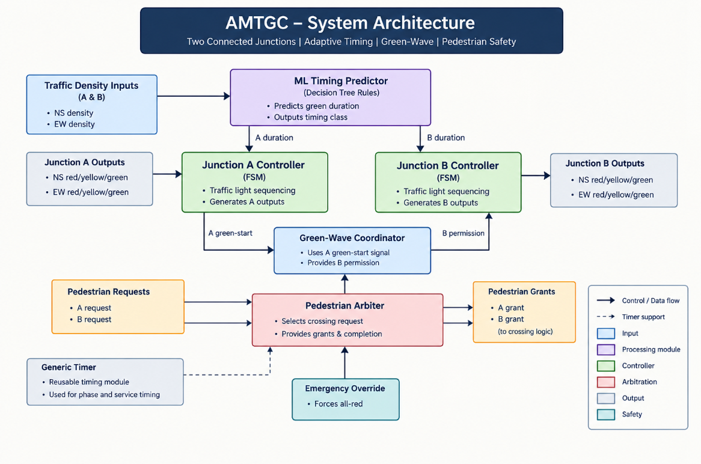

# AMTGC
## AI-Based Adaptive Multi-Junction Traffic Grid Controller

[](https://www.verilog.com/)
[](https://www.intel.com/content/www/us/en/software/programmable/quartus-prime/model-sim-intel-fpgas.html)
[]()
[]()

AMTGC is a Verilog-based traffic signal control project for two connected intersections. The design combines a decision-tree-inspired timing predictor, finite-state junction controllers, green-wave coordination, pedestrian request arbitration, and emergency override behavior in a modular RTL structure.

The implementation is organized around the modules in `rtl/`, with simulation coverage provided in `testbench/` using ModelSim Intel FPGA Edition 2020.1. The project is intended as an RTL exploration of adaptive signal timing and junction coordination rather than a production traffic-management deployment.

> Status: RTL design and simulation-focused verification for an adaptive multi-junction traffic-grid concept.

---

## Overview

Traditional fixed-time traffic controllers follow static phase durations. AMTGC instead explores adaptive green timing using traffic-density inputs and coordination between two junctions.

The system models:

- Junction A and Junction B as separate traffic controllers
- NS/EW signal sequencing through finite-state control
- Adaptive green-duration selection based on density input pairs
- Green-wave coordination between junctions
- Pedestrian request arbitration and grant handling
- Emergency override logic that forces a safe all-red condition

This repository is focused on hardware-oriented design, signal logic modeling, and simulation verification in ModelSim.

---

## System Architecture

<p align="center">
  
</p>

The architecture reflects the current implementation in `rtl/amtgc_top.v`, where the top-level controller integrates:

- `ml_timing_predictor.v` for timing-class selection
- `junction_controller.v` for phase sequencing at each intersection
- `green_wave_coordinator.v` for inter-junction timing coordination
- `ped_arbiter.v` for pedestrian request handling
- `generic_timer.v` for reusable cycle-based timing

---

## Key Features

| Feature | Implementation detail |
| --- | --- |
| Adaptive signal timing | `ml_timing_predictor.v` chooses a timing class from density inputs using decision-tree-style logic |
| Junction FSM control | `junction_controller.v` manages NS/EW green, yellow, and all-red phases |
| Green-wave coordination | `green_wave_coordinator.v` gates the second junction's green permit based on the first junction's phase progression |
| Pedestrian arbitration | `ped_arbiter.v` assigns service to competing pedestrian requests with alternating priority |
| Emergency override | `amtgc_top.v` forces both junctions into an all-red state when `emergency_override` is asserted |
| Reusable timer logic | `generic_timer.v` supports cycle-timed behavior in a modular way |
| Simulation-first validation | Dedicated testbenches in `testbench/` exercise each module and key system interactions |

---

## Module Breakdown

| Module | File | Purpose |
| --- | --- | --- |
| Top-level controller | `rtl/amtgc_top.v` | Integrates the full traffic-grid system with A/B junctions, green-wave coordination, and pedestrian grants |
| Junction controller | `rtl/junction_controller.v` | FSM-based signal sequencing for a single four-way intersection |
| ML timing predictor | `rtl/ml_timing_predictor.v` | Maps density inputs to green-duration classes: SHORT, MEDIUM, and LONG |
| Green-wave coordinator | `rtl/green_wave_coordinator.v` | Coordinates a delayed permit for Junction B when Junction A begins its NS green phase |
| Pedestrian arbiter | `rtl/ped_arbiter.v` | Tracks pending pedestrian requests and grants them with a priority toggle |
| Generic timer | `rtl/generic_timer.v` | Implements reusable cycle counting and completion logic |

### Timing predictor behavior

The predictor in `rtl/ml_timing_predictor.v` is a simple rule-based design using the density inputs `density_A_NS` and `density_A_EW` to produce one of three timing classes:

| Timing class | Duration |
| --- | ---: |
| `SHORT` | 5 cycles |
| `MEDIUM` | 8 cycles |
| `LONG` | 12 cycles |

The decision-tree structure is also captured in `ml/decision_tree_rules.txt`, which reflects the current implementation rather than a production-trained model.

---

## ML and Data Notes

The repository includes:

- `ml/decision_tree_rules.txt` — rule-based decision tree used to guide the timing predictor
- `ml/traffic_training_data.csv` — traffic-density dataset captured in the workspace for reference and experimentation

This is an implementation-level, rule-driven design rather than a validated deployment model. The timing logic is simulation-oriented and intended for architectural exploration.

---

## Technology Stack

- Verilog HDL
- ModelSim Intel FPGA Edition 2020.1
- VS Code for project organization and RTL editing
- Finite-state machine design for traffic phases
- Decision-tree-inspired adaptive control logic
- Digital simulation and waveform-based verification

---

## Project Structure

```text
AMTGC/
├── docs/
├── ml/
│   ├── decision_tree_rules.txt
│   └── traffic_training_data.csv
├── rtl/
│   ├── amtgc_top.v
│   ├── generic_timer.v
│   ├── green_wave_coordinator.v
│   ├── junction_controller.v
│   ├── ml_timing_predictor.v
│   └── ped_arbiter.v
├── screenshots/
│   ├── amtgc_top_test.png
│   ├── green_wave_timing_test_passed.png
│   ├── junction_controller_test.png
│   ├── ml_timimg_predictor test.png
│   ├── ped_arbiter test pass.png
│   └── system_architecture.png
├── testbench/
│   ├── README.md
│   ├── amtgc_top_tb.v
│   ├── generic_timer_tb.v
│   ├── green_wave_coordinator_tb.v
│   ├── green_wave_timing_tb.v
│   ├── junction_controller_tb.v
│   ├── ml_timing_predictor_tb.v
│   ├── ped_arbiter_fairness_tb.v
│   ├── ped_arbiter_tb.v
│   └── pedestrian_integration_tb.v
├── work/
├── vsim.wlf
└── README.md
```

---

## Simulation and Verification

The project is structured around simulation-based verification. The repository contains dedicated testbenches for the main RTL blocks and the integrated controller.

### Verification coverage in the repository

| Area | Testbench |
| --- | --- |
| Top-level integration | `testbench/amtgc_top_tb.v` |
| Generic timer | `testbench/generic_timer_tb.v` |
| Green-wave coordinator | `testbench/green_wave_coordinator_tb.v` |
| Green-wave timing | `testbench/green_wave_timing_tb.v` |
| Junction controller | `testbench/junction_controller_tb.v` |
| ML timing predictor | `testbench/ml_timing_predictor_tb.v` |
| Pedestrian arbiter | `testbench/ped_arbiter_tb.v` |
| Pedestrian fairness | `testbench/ped_arbiter_fairness_tb.v` |
| Pedestrian integration | `testbench/pedestrian_integration_tb.v` |

### What the current top-level bench checks

The included `amtgc_top_tb.v` checks for:

- conflicting green outputs within the same junction
- emergency override forcing all-red operation
- starting of Junction A NS green and subsequent Junction B activation in the test scenario
- simulation timeout protection

These checks are coded directly in the testbench and are specific to the current RTL implementation.

### Typical ModelSim flow

From the project root, the design can be compiled in the ModelSim transcript:

```tcl
vlib work
vlog rtl/generic_timer.v
vlog rtl/ml_timing_predictor.v
vlog rtl/junction_controller.v
vlog rtl/green_wave_coordinator.v
vlog rtl/ped_arbiter.v
vlog rtl/amtgc_top.v
```

Run an individual testbench, for example the green-wave timing case:

```tcl
vlog testbench/green_wave_timing_tb.v
vsim work.green_wave_timing_tb
add wave -r *
run -all
```

To run the top-level integration test:

```tcl
vlog testbench/amtgc_top_tb.v
vsim work.tb_amtgc_top
run -all
```

> The exact module name in the testbench should match the entity declaration inside the file. The project uses the current module names present in the repo.

---

## Verification Results

This repository is simulation-oriented and contains testbench coverage for the key RTL functions and integration points. The verification acts as a design validation layer for the current implementation and includes explicit assertions for conflict detection and emergency all-red behavior in `testbench/amtgc_top_tb.v`.

The project does not claim deployment-grade validation or real-world operational benchmarking; instead, it demonstrates the current RTL behavior under ModelSim simulation.

---

## Limitations

- The timing predictor is rule-based and uses illustrative threshold logic rather than a validated traffic dataset or trained model.
- The design is evaluated through HDL simulation, not through hardware deployment or field testing.
- The current implementation is not a safety-certified traffic-control system for real-world operation.
- Emergency and pedestrian behavior are handled in logic, but require further validation under realistic traffic and timing scenarios.

---

## Future Scope

- Replace the rule-based predictor with a data-driven or trained predictive model
- Evaluate adaptive timing against fixed-timing control scenarios
- Extend coordination to additional junctions and larger grid layouts
- Expand pedestrian and emergency test coverage under simultaneous edge cases
- Explore synthesis and FPGA implementation workflows
- Compare signal throughput and phase performance with defined traffic metrics

---

## Project Status

AMTGC is currently a simulation-driven RTL design project focused on adaptive signal timing, junction coordination, and pedestrian arbitration within a modular Verilog architecture.

It is best understood as a proof-of-concept digital control system for exploring how adaptive timing and coordination can be represented in hardware logic, rather than as a production-ready traffic management platform.

---

## Acknowledgement

This project is organized around modular Verilog design and simulation workflows, with the current repository serving as a focused implementation for exploring adaptive multi-junction traffic control behavior.
