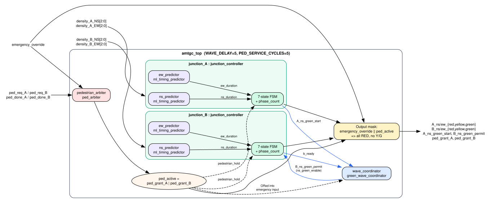
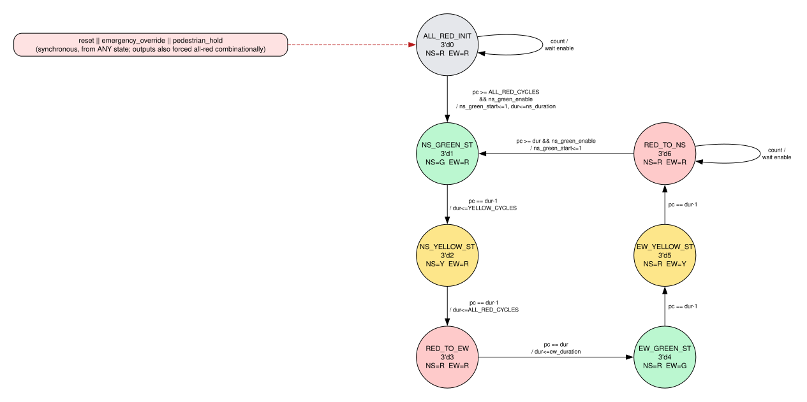
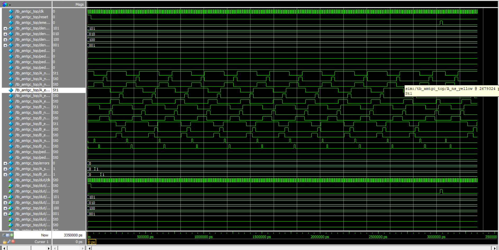

<div class="title-page" markdown="1">

<p class="tp-kicker">Internship Final Project — Technical Report</p>

# AMTGC: AI-Based Adaptive Multi-Junction Traffic Grid Controller

<p class="tp-sub">RTL Design and Simulation-Based Verification in Verilog HDL</p>

<table class="tp-meta">
<tr><td>Author</td><td>Aksshaya Rajaselvam</td></tr>
<tr><td>Email</td><td>aksshaya2006@gmail.com</td></tr>
<tr><td>Programme</td><td>VLSI Internship — Elevance Skills</td></tr>
<tr><td>Repository</td><td>https://github.com/Aksshayaa/AMTGC</td></tr>
<tr><td>HDL / Simulator</td><td>Verilog-2001 · ModelSim Intel FPGA Edition 2020.1</td></tr>
<tr><td>Submission date</td><td>28 October 2026</td></tr>
</table>

</div>

<div class="toc-page" markdown="1">

## Contents

[TOC]

</div>

## Abstract

This report describes AMTGC, a synthesizable-style Verilog RTL model of a traffic-signal controller for two adjacent four-way junctions, A and B. Each junction runs a seven-state finite-state machine (FSM) that sequences north–south (NS) and east–west (EW) green, yellow and all-red phases. Green-phase lengths are not fixed. A combinational decision-tree predictor selects a SHORT (5-cycle), MEDIUM (8-cycle) or LONG (12-cycle) green from 3-bit traffic-density inputs. A green-wave coordinator releases Junction B's NS green only after Junction A has started its NS green and a fixed offset has elapsed. A two-requester pedestrian arbiter grants crossings one at a time with alternating priority, and an emergency override forces every signal head to red within the same clock cycle.

Verification uses eleven self-checking or observational testbenches, from unit level (predictor, timer, coordinator, arbiter, junction FSM) to system level (integration, green-wave timing, density sweep, pedestrian integration and a randomized stress bench). ModelSim waveform captures recorded earlier in the project are included and interpreted. For this report, the full regression was also re-run on the final RTL with Icarus Verilog 13.0 as a cross-check. Nine of eleven benches pass, including a measured green-wave offset of exactly 5 cycles at every density mix tested. The two remaining failures were traced to testbench defects, not to the RTL: one bench checks too early for the arbiter's two-edge grant latency, and another has a zero-delay sampling race that Icarus exposes and ModelSim does not. New ModelSim captures of the final RTL show the exhaustive predictor sweep, the green-wave density test, pedestrian fairness and integration, and the stress test all passing. A third bench passed only because two of its DUT inputs were unconnected; with the author's approval those ports were connected, and it now exercises all seven FSM states. The review also found that several earlier ModelSim captures predate the final RTL, and that the decision tree agrees with the dataset it was derived from on 95.3 % of rows. All of these findings are reported openly.

## 1. Project Overview and Problem Statement

Fixed-time traffic signals allocate the same green time to every approach regardless of demand. When one approach is congested and the crossing road is nearly empty, vehicles queue in front of a red light while the green is wasted. Adjacent junctions that are timed independently also break platoons of vehicles: a car released by one junction arrives at the next one on red.

The project asks whether these behaviours can be described directly in digital hardware as a small, deterministic, clocked controller that:

1. adapts each green phase to measured traffic density,
2. coordinates two junctions so that a "green wave" travels from A to B,
3. serves pedestrian crossing requests fairly, and
4. gives absolute priority to an emergency override that makes all approaches red.

AMTGC answers this question at register-transfer level (RTL). It is a design and verification exercise in simulation. It is not a deployable or safety-certified traffic controller.

## 2. Objectives and Scope

### 2.1 Objectives

| # | Objective | Where addressed |
|---|---|---|
| O1 | Implement a per-junction FSM with NS/EW green, yellow and all-red phases that never shows conflicting greens | `rtl/junction_controller.v` |
| O2 | Select green duration adaptively from 3-bit density inputs using a decision-tree model | `rtl/ml_timing_predictor.v`, `ml/` |
| O3 | Coordinate Junction B's NS green relative to Junction A's NS green start | `rtl/green_wave_coordinator.v` |
| O4 | Arbitrate pedestrian requests from both junctions, one crossing at a time, without starvation | `rtl/ped_arbiter.v` |
| O5 | Force all-red at both junctions on emergency override | `rtl/amtgc_top.v`, `rtl/junction_controller.v` |
| O6 | Verify each block and the integrated system with ModelSim testbenches and waveform analysis | `testbench/` |

### 2.2 In scope

- Behavioural/RTL Verilog for two junctions and their supporting logic.
- Cycle-based timing, where all durations are counted in clock cycles.
- Functional simulation in ModelSim.

### 2.3 Out of scope

- Synthesis, timing closure, FPGA or ASIC implementation and hardware testing. **None of these were performed.**
- Real sensor interfacing, debouncing, metastability handling of asynchronous inputs, and conversion of cycles to wall-clock seconds.
- Safety certification or compliance with any traffic-engineering standard.

## 3. System Architecture

<figure>

<figcaption>Figure 1 – AMTGC top-level structure drawn from the instantiations and port connections in <code>rtl/amtgc_top.v</code>. Blue edges are the green-wave handshake. Dashed edges carry the pedestrian hold. <code>emergency_override</code> also feeds both junction controllers and the coordinator directly; those edges are omitted for readability.</figcaption>
</figure>

`amtgc_top` instantiates the following blocks:

- **`junction_A`, `junction_B`** – two instances of `junction_controller`. Each contains two `ml_timing_predictor` instances, one producing the NS green length and one producing the EW green length, plus the phase FSM. Junction A's `ns_green_enable` is tied to `1'b1`, so A runs freely. Junction B's `ns_green_enable` is driven by the coordinator.
- **`wave_coordinator`** – a `green_wave_coordinator` that watches Junction A's one-cycle `ns_green_start` pulse and Junction B's `b_ready` flag, and issues a one-cycle `B_ns_green_permit`.
- **`pedestrian_arbiter`** – a `ped_arbiter` that turns rising edges on `ped_req_A/B` into pending requests and grants one junction at a time until the matching `ped_done_A/B` arrives.
- **Output masking** – `ped_active = ped_grant_A | ped_grant_B`. When `emergency_override || ped_active` is true, every red output is forced to 1 and every yellow and green output to 0. The same condition resets both junction FSMs to `ALL_RED_INIT`. `ped_active` is also ORed into the coordinator's emergency input, which cancels any pending green-wave permit.

The diagram in `screenshots/system_architecture.png` is an earlier conceptual drawing. It shows a single shared predictor and a generic timer that serves the arbiter. In the final RTL, each junction owns two predictors and `generic_timer` is **not instantiated** in `amtgc_top` (see Section 13). Figure 1 reflects the code as committed.

### 3.1 Top-level interface

| Port | Dir | Width | Description |
|---|---|---|---|
| `clk` | in | 1 | System clock. All sequential logic uses `posedge clk`. |
| `reset` | in | 1 | Active-high **synchronous** reset. |
| `emergency_override` | in | 1 | Active-high. All heads red, pedestrian grants suppressed, FSMs held in `ALL_RED_INIT`. |
| `density_{A,B}_{NS,EW}` | in | 3 | Traffic-density level 0–7 per approach. |
| `ped_req_A/B` | in | 1 | Pedestrian request. The **rising edge** registers a request. |
| `ped_done_A/B` | in | 1 | Crossing complete. Ends the current grant. |
| `{A,B}_{ns,ew}_{red,yellow,green}` | out | 1 each | Twelve signal-head outputs. |
| `A_ns_green_start` | out | 1 | One-cycle pulse when Junction A enters NS green. |
| `B_ns_green_permit` | out | 1 | One-cycle permit from the coordinator to Junction B. |
| `ped_grant_A/B` | out | 1 | Active pedestrian grant. Mutually exclusive by construction. |

Parameters: `WAVE_DELAY` (default 5) is passed to the coordinator. `PED_SERVICE_CYCLES` (default 5) is declared but **not used** inside `amtgc_top`; crossing length is determined by the external `ped_done_*` inputs.

## 4. RTL Design and Module Descriptions

| Module | File | Type | Lines | Role |
|---|---|---|---|---|
| `amtgc_top` | `rtl/amtgc_top.v` | Structural + combinational mask | 126 | Integration, output masking |
| `junction_controller` | `rtl/junction_controller.v` | Sequential FSM + combinational outputs | 194 | Per-junction phase sequencing |
| `ml_timing_predictor` | `rtl/ml_timing_predictor.v` | Combinational | 65 | Density → timing class / duration |
| `green_wave_coordinator` | `rtl/green_wave_coordinator.v` | Sequential | 47 | A→B offset and permit |
| `ped_arbiter` | `rtl/ped_arbiter.v` | Sequential FSM + combinational grants | 118 | Pedestrian arbitration |
| `generic_timer` | `rtl/generic_timer.v` | Sequential | 53 | Reusable cycle timer (unit-tested; not instantiated in the top level) |

### 4.1 `ml_timing_predictor` – decision-tree timing class

The predictor is purely combinational. It implements exactly the tree stored in `ml/decision_tree_rules.txt`, with thresholds such as `density_A_NS <= 4.50` turned into integer comparisons (`<= 4`). Its output `timing_class` is 2'b00 = SHORT (5 cycles), 2'b01 = MEDIUM (8) or 2'b10 = LONG (12), and `green_duration` is decoded from it. Encoding 2'b11 is never produced and falls back to 5 cycles.

In each junction, the NS predictor receives `(density_NS, density_EW)` and the EW predictor receives the **swapped** pair `(density_EW, density_NS)`. The same tree therefore sizes each direction's green from "own density first, crossing density second". Table 1 lists the full 8 × 8 decision surface, derived from the RTL source.

| NS \ EW | 0 | 1 | 2 | 3 | 4 | 5 | 6 | 7 |
|---|---|---|---|---|---|---|---|---|
| **0** | S | S | S | S | S | S | S | S |
| **1** | S | S | S | S | S | S | S | M |
| **2** | S | S | S | S | M | M | M | M |
| **3** | M | M | M | M | M | M | M | M |
| **4** | M | M | M | M | L | L | L | L |
| **5** | M | M | M | L | L | L | L | L |
| **6** | L | L | L | L | L | L | L | L |
| **7** | L | L | L | L | L | L | L | L |

<p class="caption">Table 1 – Timing class produced by <code>ml_timing_predictor</code> (S = 5, M = 8, L = 12 cycles), first input as the row and second input as the column.</p>

**Agreement with the dataset.** `ml/traffic_training_data.csv` holds 4 096 labelled rows: every combination of the four 3-bit densities. Its labels depend only on `density_A_NS` and `density_A_EW`. A Python transcription of the RTL rules (Appendix C) was compared with every row for this report. **3 904 of 4 096 rows (95.31 %) agree.** The 192 disagreements fall in exactly three (NS, EW) cells, each repeated 64 times across the B-density columns:

| (NS, EW) | Dataset label | RTL / tree output |
|---|---|---|
| (3, 0) | SHORT | MEDIUM |
| (4, 4) | MEDIUM | LONG |
| (4, 5) | MEDIUM | LONG |

The tree is therefore a compact approximation of the labelling rule, not an exact copy. This trade-off is typical of a depth-limited decision tree. The ML training script that produced the tree is not in the repository, so the tree's depth and training settings cannot be reported.

### 4.2 `junction_controller` – phase sequencing

This block is described in detail in Section 5. Its key implementation choices are:

- **Single-process FSM with a phase counter.** `state`, `phase_count` (16-bit) and `phase_duration` (16-bit) are registered together in one `always @(posedge clk)` block. Each state counts up to its stored duration, then loads the duration for the next state on the same edge.
- **Duration latched on phase entry.** `phase_duration <= ns_duration` is loaded when NS green is entered, so a density change during green does not stretch or truncate the green already running. New densities take effect at the next green.
- **Moore outputs from a separate combinational block.** The lamps depend only on `state` and are gated by `!emergency_override && !pedestrian_hold`. This gating makes the emergency response **combinational**: lamps go red in the same cycle the override is asserted, without waiting for a clock edge.
- **`b_ready`** is asserted when the FSM is in `ALL_RED_INIT` or `RED_TO_NS` and the minimum all-red time has elapsed. In other words, the junction is safe to start NS green.

### 4.3 `green_wave_coordinator`

The coordinator has one wait flag, a 16-bit counter and a registered one-cycle permit. On an `a_ns_green_start` pulse it arms `waiting_for_b` and clears the counter. It counts to `COUNT_TARGET = WAVE_DELAY − 3`, which is 2 for the default `WAVE_DELAY = 5`, and then issues `b_ns_green_permit` on the first cycle in which `b_ready` is also high. The "−3" compensates for pipeline latency elsewhere in the path: one cycle for the registered start pulse, one for the registered permit, and one for Junction B's state register. With this compensation, the observable offset from Junction A's start pulse to Junction B's NS green lamp equals `WAVE_DELAY` cycles (Section 10.5). A new start pulse that arrives while the coordinator is already waiting is ignored. `reset`, `emergency_override` or `ped_active` clears the coordinator.

### 4.4 `ped_arbiter`

The arbiter is a three-state FSM (`IDLE`, `SERVING_A`, `SERVING_B`) with these features:

- **Edge detection and pending latches.** `ped_req_X && !ped_req_X_d` sets `pending_X`. A short press is therefore remembered, and holding the button does not create repeated requests.
- **Alternating priority.** `next_priority` selects the winner when both requests are pending. It flips to the other junction whenever a service completes (`SERVING_A` + `ped_done_A` sets priority to B, and vice versa), so neither side can starve the other.
- **Mutually exclusive grants.** `ped_grant_A/B` are decoded from `ped_state` in an `if / else if`, so they can never both be 1. Both are forced to 0 while `reset` or `emergency_override` is asserted.
- **Latency.** Two rising clock edges separate a request edge from its grant: one edge registers `pending_X` and the next moves the FSM out of `IDLE`.

### 4.5 `generic_timer`

`generic_timer` is a parameterised (`WIDTH = 16`) start/done timer. A `start` pulse while idle loads `duration`. `active` stays high for `duration` cycles and `done` then pulses for one cycle. `duration == 0` produces an immediate `done`. A `start` that arrives while `active` is high is ignored. The module is verified by `generic_timer_tb.v` but is not used by the other modules: each FSM keeps its own `phase_count`.

## 5. FSM Design

<figure>

<figcaption>Figure 2 – State diagram of <code>junction_controller</code>, drawn from the RTL. <code>pc</code> = <code>phase_count</code>, <code>dur</code> = <code>phase_duration</code>. Defaults: <code>YELLOW_CYCLES = 3</code>, <code>ALL_RED_CYCLES = 2</code>.</figcaption>
</figure>

### 5.1 State encoding and outputs

The FSM uses binary encoding on a 3-bit `state` register. Encoding 3'd7 is unused, and the `default` branch recovers it to `ALL_RED_INIT`.

| Code | State | NS lamp | EW lamp | Duration in state (cycles) |
|---|---|---|---|---|
| 3'd0 | `ALL_RED_INIT` | R | R | ≥ 3 (ALL_RED_CYCLES + 1), then waits for `ns_green_enable` |
| 3'd1 | `NS_GREEN_ST` | **G** | R | `ns_duration` = 5 / 8 / 12 |
| 3'd2 | `NS_YELLOW_ST` | **Y** | R | YELLOW_CYCLES = 3 |
| 3'd3 | `RED_TO_EW` | R | R | ALL_RED_CYCLES + 1 = 3 |
| 3'd4 | `EW_GREEN_ST` | R | **G** | `ew_duration` = 5 / 8 / 12 |
| 3'd5 | `EW_YELLOW_ST` | R | **Y** | YELLOW_CYCLES = 3 |
| 3'd6 | `RED_TO_NS` | R | R | ≥ 3, then waits for `ns_green_enable` |

<p class="caption">Table 2 – State encoding, lamp outputs and dwell times, derived by inspection of <code>rtl/junction_controller.v</code>.</p>

Green and yellow states compare `pc < dur − 1` and therefore last exactly `dur` cycles. The all-red states compare `pc < dur` and last `dur + 1` cycles. This difference is noted as observation OBS-03 in the bug log. It is safe, because it lengthens the clearance interval, but it is not symmetric.

**Cycle length.** With Junction A free-running (`ns_green_enable = 1`), one full cycle takes `G_NS + 3 + 3 + G_EW + 3 + 3 = G_NS + G_EW + 12` clock cycles, ranging from 22 cycles (5 + 5) to 36 cycles (12 + 12). For the integration-test densities (A: NS = 5, EW = 2), both predictors select MEDIUM, giving 8 + 8 + 12 = **28 cycles**.

### 5.2 State-transition table

| Current state | Condition (evaluated at `posedge clk`) | Next state | Registered side effects |
|---|---|---|---|
| any | `reset \|\| emergency_override \|\| pedestrian_hold` | `ALL_RED_INIT` | `pc←0`, `dur←ALL_RED_CYCLES`, `ns_green_start←0` |
| `ALL_RED_INIT` | `pc < ALL_RED_CYCLES` | same | `pc←pc+1` |
| `ALL_RED_INIT` | `pc ≥ ALL_RED_CYCLES && ns_green_enable` | `NS_GREEN_ST` | `pc←0`, `dur←ns_duration`, `ns_green_start←1` |
| `NS_GREEN_ST` | `pc == dur−1` | `NS_YELLOW_ST` | `pc←0`, `dur←YELLOW_CYCLES` |
| `NS_YELLOW_ST` | `pc == dur−1` | `RED_TO_EW` | `pc←0`, `dur←ALL_RED_CYCLES` |
| `RED_TO_EW` | `pc == dur` | `EW_GREEN_ST` | `pc←0`, `dur←ew_duration` |
| `EW_GREEN_ST` | `pc == dur−1` | `EW_YELLOW_ST` | `pc←0`, `dur←YELLOW_CYCLES` |
| `EW_YELLOW_ST` | `pc == dur−1` | `RED_TO_NS` | `pc←0`, `dur←ALL_RED_CYCLES` |
| `RED_TO_NS` | `pc ≥ dur && ns_green_enable` | `NS_GREEN_ST` | `pc←0`, `dur←ns_duration`, `ns_green_start←1` |
| 3'd7 | — | `ALL_RED_INIT` | defaults |

<p class="caption">Table 3 – Junction controller state-transition table. In every non-listed case the FSM stays in its state and increments <code>pc</code>.</p>

### 5.3 Safety properties by construction

- **No conflicting greens.** Each state turns on at most one direction's green or yellow, and the output block assigns safe defaults (both red) before the `case`. No state can drive `ns_green` and `ew_green` together.
- **Yellow then all-red between directions.** Every path from one direction's green to the other's passes through a yellow state and then an all-red state.
- **Override dominance.** The override and pedestrian hold are checked before the `case` in the sequential block, and they gate the output block. They are also re-applied at the top level, so a hold forces all-red even before the FSM register updates.

### 5.4 Pedestrian-arbiter FSM

| Current | Condition | Next | Side effects |
|---|---|---|---|
| any | `reset` | `IDLE` | priority ← A, pending and edge registers cleared |
| any | `emergency_override` | `IDLE` | pending flags kept |
| `IDLE` | `pending_A && pending_B` | `SERVING_A` if `next_priority == 0`, else `SERVING_B` | — |
| `IDLE` | only `pending_A` / only `pending_B` | `SERVING_A` / `SERVING_B` | — |
| `SERVING_A` | `ped_done_A` | `IDLE` | `pending_A←0`, `next_priority←1` |
| `SERVING_B` | `ped_done_B` | `IDLE` | `pending_B←0`, `next_priority←0` |

<p class="caption">Table 4 – <code>ped_arbiter</code> transitions. Grants are combinational decodes of <code>ped_state</code>.</p>

## 6. Clock, Reset and Signal Behaviour

- **Clock.** The design has a single clock domain, and every register is clocked on `posedge clk`. The testbenches use a 10 ns period (`always #5 clk = ~clk`), i.e. 100 MHz in simulation. That period is a testbench convenience, **not a design requirement**. No target clock frequency is specified, and no timing analysis was run (see `docs/ASSUMPTIONS.md` A-01).
- **Time base.** All durations are in clock cycles. Mapping cycles to seconds would need a clock-enable or prescaler, which is not implemented.
- **Reset.** Reset is active-high and **synchronous** (`if (reset ...)` inside `always @(posedge clk)`). After reset, both junctions are in `ALL_RED_INIT`, the coordinator is idle, the arbiter is `IDLE` with priority to A, and all lamps are red. The combinational outputs of `ped_arbiter` also check `reset` directly, so grants are 0 during reset.
- **Emergency override.** This level-sensitive input acts in two ways: (a) **combinationally**, so lamps go red and grants drop to 0 in the same delta cycle, and (b) **synchronously**, so on the next edge the FSMs return to `ALL_RED_INIT` and the coordinator clears. On release, each junction repeats the 3-cycle initial all-red before Junction A restarts NS green.
- **Pedestrian hold.** While either grant is active, both junctions are held in `ALL_RED_INIT` with all lamps red. When the grant ends, A restarts at NS green and B waits for a fresh green-wave permit.
- **Asynchronous inputs.** Density, request, done and override inputs are assumed to be synchronous to `clk`. The design has no synchronisers (`docs/ASSUMPTIONS.md` A-05).

## 7. Verification Methodology

Verification is simulation-based, using directed and constrained-random stimulus in ModelSim. It is applied bottom-up:

1. **Unit level.** Each leaf module is exercised in isolation with directed stimulus. The predictor additionally receives an exhaustive 64-point sweep.
2. **Integration level.** `amtgc_top` is driven with fixed densities to check phase sequencing, the A→B green-wave relationship, emergency behaviour and pedestrian service.
3. **Stress level.** Emergency is injected in every visible phase, reset is applied mid-operation, emergencies are repeated, and 100 random density samples are applied while concurrent checkers watch safety invariants.

Checks are made in three ways:

- **Concurrent checkers.** `always @(negedge clk)` blocks flag conflicting greens, simultaneous pedestrian grants and all-red violations during emergency or pedestrian service, sampling midway between active edges.
- **Directed assertions.** `if (...) $display("PASS…") else $display("FAIL…")` statements at specific points, with an `errors` counter in most benches.
- **Watchdogs.** Every system-level bench has a `#N $finish` timeout so that a hang is reported rather than running forever.

No SystemVerilog assertions, functional coverage or code-coverage metrics were used (see Section 13).

## 8. Testbench Architecture and Test Scenarios

| # | Testbench file | Top module | DUT | Scenarios | Self-checking |
|---|---|---|---|---|---|
| T1 | `generic_timer_tb.v` | `tb_generic_timer` | `generic_timer` | 4-cycle timing run, waits for `done` | Partial (prints PASS on `done`; timeout = FAIL) |
| T2 | `ml_timing_sweep_tb.v` | `ml_timing_sweep_tb` | `ml_timing_predictor` | All 64 (NS, EW) pairs; checks class↔duration consistency and 5–12 range | Yes |
| T3 | `ml_timing_predictor_tb.v` | — | — | **File is empty (0 bytes) in this commit.** Previous directed version survives as `ml_timing_predictor_tb.v.bak` (9 golden vectors). | — (BUG-01) |
| T4 | `junction_controller_tb.v` | `tb_junction_controller` | `junction_controller` | 40 cycles of run, then emergency mid-run, recovery | Yes (ports connected 28 Oct, BUG-02) |
| T5 | `green_wave_coordinator_tb.v` | `tb_green_wave_coordinator` | `green_wave_coordinator` | No permit while B not ready; permit when ready; one-cycle pulse; emergency cancels | Yes |
| T6 | `ped_arbiter_tb.v` | `tb_ped_arbiter` | `ped_arbiter` | A only; B only; simultaneous; emergency suppresses | Prints PASS/FAIL, no error count (see BUG-03) |
| T7 | `ped_arbiter_fairness_tb.v` | `tb_ped_arbiter_fairness` | `ped_arbiter` | Two rounds of simultaneous requests; both served; order recorded | Yes |
| T8 | `amtgc_top_tb.v` | `tb_amtgc_top` | `amtgc_top` | 300-cycle run; A start seen; B NS green seen; emergency all-red; release | Yes |
| T9 | `green_wave_timing_tb.v` | `tb_green_wave_timing` | `amtgc_top` | Measures A start-pulse → B NS-green offset; pass window 5–6 cycles | Yes |
| T10 | `green_wave_density_tb.v` | `green_wave_density_tb` | `amtgc_top` | Five density mixes; B NS green ≥ 5 cycles after A start; no conflicts | Yes |
| T11 | `pedestrian_integration_tb.v` | `tb_pedestrian_integration` | `amtgc_top` | A grant, B grant, simultaneous, emergency during grant; all-red during service | Yes |
| T12 | `amtgc_stress_tb.v` | `amtgc_stress_tb` | `amtgc_top` | Emergency in all-red, NS-G, NS-Y, EW-G, EW-Y; reset mid-run; 3 repeated emergencies; 100 random densities | Yes |

<p class="caption">Table 5 – Testbench inventory. Every bench drives a 10 ns clock.</p>

## 9. Simulation Setup and Execution Procedure

**Tool:** ModelSim Intel FPGA Edition 2020.1. The vendor string `vlog 2020.1 2020.02` appears in the committed `work/_info`. The committed library shows a Windows working directory, which indicates that the recorded runs were made on a Windows host.

**Interactive (GUI) flow**, from the repository root in the ModelSim transcript window:

```tcl
vlib work
vlog -timescale 1ns/1ps rtl/generic_timer.v rtl/ml_timing_predictor.v rtl/junction_controller.v \
     rtl/green_wave_coordinator.v rtl/ped_arbiter.v rtl/amtgc_top.v
vlog -timescale 1ns/1ps testbench/green_wave_timing_tb.v
vsim work.tb_green_wave_timing
add wave -r /*
run -all
```

`-timescale 1ns/1ps` gives a default to the three source files that do not declare `` `timescale ``. Without it, ModelSim may report a vsim-3009 time-scale mismatch.

**Batch regression.** `scripts/run_all.do` compiles all RTL, runs every non-empty testbench in turn and writes one transcript per bench to `sim_logs/`:

```bash
vsim -c -do scripts/run_all.do
```

**Cross-check simulator.** The same benches were run with Icarus Verilog 13.0 (`bash scripts/run_iverilog.sh`), unmodified, against the committed RTL. Logs are in `sim_logs/iverilog/`.

## 10. Simulation Results and Waveform Analysis

### 10.0 Regression results on the committed RTL (Icarus Verilog 13.0)

| Bench | Result | Key output (verbatim from log) |
|---|---|---|
| T1 `tb_generic_timer` | PASS | `PASS: Timer completed.` |
| T2 `ml_timing_sweep_tb` | PASS | `Density combinations tested: 64`, `Errors: 0`, `ML TIMING SWEEP PASSED` |
| T3 `tb_ml_timing_predictor` (run from the `.bak` copy) | PASS | 9 × `PASS: NS=… EW=…`, `ALL ML PREDICTOR TESTS PASSED` |
| T4 `tb_junction_controller` | PASS (after the BUG-02 fix) | `state` 0→1→2→3→4→5→6→1…; emergency forces 4→0, then recovery; `ALL JUNCTION CONTROLLER TESTS PASSED`. Before the fix, the FSM stayed at `state=0` (vacuous pass). |
| T5 `tb_green_wave_coordinator` | PASS | 3 × PASS, `ALL GREEN-WAVE TESTS PASSED` |
| T6 `tb_ped_arbiter` | **FAIL (bench)** | `FAIL: A was not granted`, `FAIL: B was not granted`, then 2 × PASS (BUG-03) |
| T7 `tb_ped_arbiter_fairness` | PASS | `ALL PEDESTRIAN FAIRNESS TESTS PASSED` |
| T8 `tb_amtgc_top` | PASS | 3 × PASS, `ALL AMTGC TOP-LEVEL TESTS PASSED` |
| T9 `tb_green_wave_timing` | PASS | `A … cycle = 4`, `B … cycle = 9`, `Measured start-to-start delay = 5 cycles`, `GREEN-WAVE TIMING TEST PASSED` |
| T10 `green_wave_density_tb` | PASS | Delay = **5** cycles in all five density mixes, `GREEN-WAVE DENSITY TEST PASSED` |
| T11 `tb_pedestrian_integration` | PASS | Winner A, then B; emergency suppresses grants; `ALL PEDESTRIAN INTEGRATION TESTS PASSED` |
| T12 `amtgc_stress_tb` | **FAIL in Icarus (bench race); PASS in ModelSim (Fig. 15)** | All 8 directed emergency checks, the reset check and the 100 random samples pass, but the concurrent checker logs `Emergency all-red violation` at 120 ns and 680 ns (BUG-06) |

<p class="caption">Table 6 – Regression on commit 5b1b9a4 RTL, Icarus Verilog 13.0, logs in <code>sim_logs/iverilog/</code>.</p>

**Analysis of the T12 failures.** A probe module (`$monitor` on the bench's signals, not committed) shows that at both timestamps the stimulus raises `emergency_override` in the *same* timestep as the `negedge clk` on which the concurrent checker samples. The checker reads the new override value before the combinational lamp outputs have propagated. By the end of the same timestep (zero simulated time later), all four reds are 1 and all greens are 0, and the directed check `#1` later prints PASS. The failure is therefore a race between two testbench processes, not a late response from the RTL. ModelSim's ordering does not expose it: the same bench passes there (Fig. 15).

### 10.1 Top-level integration (T8)

<figure>

<figcaption>Figure 3 – <code>tb_amtgc_top</code>, 0–3.35 µs. Densities A = (5, 2), B = (4, 1). Recorded capture.</figcaption>
</figure>

**What it shows.** After reset is released, both junctions cycle continuously. The `A_ns_green_start` pulses (row "A_n…" near the bottom) recur roughly every 280 ns. That matches the 28-cycle cycle length predicted in Section 5.1 for densities (5, 2). Each `B_ns_green_permit` pulse follows an A start pulse by a few cycles, which is the green-wave relationship. The `errors` bus remains 0, and the testbench flags `A_started` and `B_started` change 0 → 1 early in the run. The emergency pulse near 3.05 µs is followed by both junctions' lamp rows going to the all-red pattern. At the cursor the `Msgs` column shows `errors = 0`.

**Status.** The run time (3.35 µs ≈ 335 cycles) matches the bench's stimulus length. Nothing in the capture conflicts with the committed RTL, but the PASS lines were not captured. **Re-capture with the transcript visible is recommended.**

### 10.2 Junction controller (T4)

<figure>

<figcaption>Figure 4 – <code>tb_junction_controller</code> on the final RTL with the BUG-02 bench fix, densities (1, 1), window ≈ 330–630 ns. ModelSim capture, 28 Oct 2026.</figcaption>
</figure>

**What it shows.** The DUT signal list now includes `ns_green_enable` (St1), `pedestrian_hold` (St0), `ns_green_start` and `b_ready`, which confirms that this is the final `junction_controller` with its ports connected. In the visible window, `state` steps 010 (NS yellow) → 011 (all-red) → 100 (EW green). The emergency pulse near 420 ns forces the FSM to 000 (`ALL_RED_INIT`) and all lamps to red. `b_ready` then rises once the all-red minimum has elapsed, `ns_green_start` pulses, and the FSM resumes 001 → 010 → 011 → 100 → 101. NS and EW greens never overlap. `ns_duration` = `ew_duration` = 0101 (5 cycles, SHORT), as Table 1 predicts for (1, 1), and `errors` stays 0.

**Coverage note.** State 110 (`RED_TO_NS`) lies outside this zoomed window. The full 0→1→2→3→4→5→6→1 sequence is recorded in the Icarus log of the same bench (`sim_logs/iverilog/tb_junction_controller.log`, Table 6). Before the bench fix, the two unconnected inputs floated to `z` and the FSM never left `ALL_RED_INIT` (BUG-02). An earlier ModelSim capture from a previous RTL revision remains in `screenshots/junction_controller_test.png` for reference.

### 10.3 ML timing predictor (T3, earlier directed bench)

<figure>

<figcaption>Figure 5 – <code>tb_ml_timing_predictor</code> directed vectors. Recorded capture.</figcaption>
</figure>

**What it shows.** Nine directed vectors: (0,0)→00/5, (1,7)→01/8, (2,2)→00/5, (3,4)→01/8, (4,4)→10/12, (5,2)→01/8, (5,3)→10/12, (6,0)→10/12 and (7,7)→10/12. DUT outputs equal `expected_class` and `expected_duration` throughout, and `errors` = 0. Every vector matches Table 1, so the capture is **consistent with the committed predictor RTL**. However, the bench that produced it now exists only as a `.bak` file, because `ml_timing_predictor_tb.v` is empty (BUG-01). The exhaustive `ml_timing_sweep_tb.v` (T2) supersedes it, but no capture of T2 exists.

### 10.4 Pedestrian arbiter (T6)

<figure>

<figcaption>Figure 6 – <code>tb_ped_arbiter</code>. Recorded capture.</figcaption>
</figure>

**What it shows.** In sequence: a grant to A, completion, a grant to B, completion, then simultaneous requests with exactly one grant (A). Asserting the emergency drops all grants. `ped_state` follows 00 → 01 → 00 → 10 → 00 → 01 → 00, and the two grants are never high together.

**Status: stale relative to the committed RTL.** The DUT signal list shows only `next_priority` and `ped_state`; the `pending_A/B` and `ped_req_*_d` registers of the current arbiter are absent. In the capture, the grant rises on the **first** clock edge after the request, whereas the current edge-detect-plus-pending design needs **two** edges. Tracing the current RTL against the current `ped_arbiter_tb.v` predicts that tests 1 and 2 print `FAIL: A was not granted` / `FAIL: B was not granted`. The checks occur one edge too early, and because `ped_done_A` arrives while the arbiter is still `IDLE`, A's service is never closed (BUG-03). The Icarus run on the committed RTL **confirms** both FAIL lines (Table 6). The arbiter itself behaves correctly in the latency-tolerant benches T7 and T11, which pass.

### 10.5 Green-wave timing (T9)

<figure>

<figcaption>Figure 7 – <code>tb_green_wave_timing</code> on the final RTL, densities A = (5, 2), B = (4, 1). ModelSim capture, 28 Oct 2026.</figcaption>
</figure>

**What it shows.** `a_start_cycle = 4`, `b_start_cycle = 9`, **`measured_delay = 5`** and **`errors = 0`**: the bench's 5–6-cycle pass window is met. In the waveform, every `B_ns_green_permit` pulse follows an `A_ns_green_start` pulse by the same offset, and B's NS green follows each permit. Both junctions cycle continuously with no conflicting greens. The bench does not connect the pedestrian inputs, so they appear as `HiZ`. The arbiter never registers a request, which is harmless for this test.

**Why the result is exactly 5.** A cycle-by-cycle trace of the coordinator (`COUNT_TARGET = WAVE_DELAY − 3 = 2`) against this bench:

| Rising edge after reset | Event |
|---|---|
| 1–2 | Both junctions count `pc` 0→2 in `ALL_RED_INIT`. B's `b_ready` becomes 1. |
| 3 | A enters `NS_GREEN_ST` and `ns_green_start ← 1`. |
| 4 | Bench samples the start pulse: **a_start_cycle = 4**. Coordinator arms, `delay_count ← 0`. |
| 5, 6 | `delay_count` 0 → 1 → 2. |
| 7 | `delay_count ≥ 2 && b_ready` sets `b_ns_green_permit ← 1`. |
| 8 | B sees `ns_green_enable` and enters `NS_GREEN_ST`. |
| 9 | Bench samples `B_ns_green = 1`: **b_start_cycle = 9**. |

The trace, the Icarus run (Table 6) and this ModelSim capture all agree on 5 cycles. T10 measures 5 cycles for all five density mixes as well (Fig. 10).

**History (BUG-04).** An earlier capture of this bench, taken on a previous RTL revision, recorded `b_start_cycle = 11`, `measured_delay = 7` and `errors = 1`: a failed check, despite being saved as `…_passed.png`. The two-cycle difference is consistent with a larger `COUNT_TARGET` before the latency compensation was added. That capture has since been removed from the repository.

### 10.6 Benches without a waveform capture

T2, T4, T7, T9, T10, T11 and T12 now have ModelSim captures on the final RTL (§10.2, §10.5, §10.7). T1 and T5 have only the Icarus results in Table 6. One limitation of T7 remains: its round-2 check proves only that both requests were served, not strict alternation of priority (see Section 13).

### 10.7 ModelSim captures on the final RTL (28 Oct 2026)

The following captures were made by the author in ModelSim Intel FPGA Edition 2020.1 on the committed RTL, and added to the repository in commit `7f5983b`. The signal lists include registers that exist only in the final RTL (e.g. `pending_A/B` and `ped_req_*_d` in the arbiter), which confirms the revision.

<figure>

<figcaption>Figure 8 – <code>ml_timing_sweep_tb</code>: <code>density_A_NS</code> steps 0–7 and, within each, <code>density_A_EW</code> steps 0–7. <code>timing_class</code> and <code>green_duration</code> follow Table 1 (e.g. NS = 3 gives 01 / 1000 = MEDIUM / 8 for every EW). <code>tests</code> reaches 64 and <code>errors</code> stays 0.</figcaption>
</figure>

<figure>

<figcaption>Figure 9 – Transcript: <code>Density combinations tested: 64</code>, <code>Errors: 0</code>, <code>ML TIMING SWEEP PASSED</code>.</figcaption>
</figure>

<figure>

<figcaption>Figure 10 – <code>green_wave_density_tb</code>, five density mixes (<code>test_num</code> 0–4). In every test, <code>delay_cycles</code> settles at <b>5</b>. Each <code>B_ns_green_permit</code> pulse follows an <code>A_ns_green_start</code> pulse, B's NS green follows the permit, and <code>errors</code> stays 0. Green durations visibly change with density: A's NS green is longest in test 3, where <code>density_A_NS</code> = 7.</figcaption>
</figure>

<figure>

<figcaption>Figure 11 – <code>tb_ped_arbiter_fairness</code> on the final arbiter. Simultaneous request edges set <code>pending_A</code> and <code>pending_B</code> one edge later. <code>ped_state</code> then goes 00 → 01 (serve A) → 00 → 10 (serve B) → 00, and <code>next_priority</code> flips after each completion. The grants never overlap.</figcaption>
</figure>

<figure>

<figcaption>Figure 12 – Transcript: <code>ALL PEDESTRIAN FAIRNESS TESTS PASSED</code>.</figcaption>
</figure>

<figure>

<figcaption>Figure 13 – <code>tb_pedestrian_integration</code> (<code>amtgc_top</code>). Whenever <code>ped_grant_A</code> or <code>ped_grant_B</code> is high, every vehicle green and yellow is low and every red is high. The emergency pulse near 290 ns drops the active grant. <code>errors</code> stays 0.</figcaption>
</figure>

<figure>

<figcaption>Figure 14 – Transcript: all checks PASS, winner A then B, <code>ALL PEDESTRIAN INTEGRATION TESTS PASSED</code>.</figcaption>
</figure>

<figure>

<figcaption>Figure 15 – <code>amtgc_stress_tb</code> transcript: 8 emergency checks, 1 reset check, 3 repeated emergencies and 100 random density samples. <code>AMTGC STRESS TEST PASSED</code> at 2 440 ns.</figcaption>
</figure>

**Cross-simulator note.** The stress bench passes in ModelSim but reports two concurrent-checker hits in Icarus (Table 6). That is the signature of a zero-delay race between testbench processes: the outcome depends on each simulator's event ordering (BUG-06). In both simulators the RTL drives all-red within the same timestep.

## 11. Challenges Faced and Solutions

This section is limited to issues for which the repository provides evidence. The author should add first-hand context where appropriate.

1. **Green-wave offset off by two cycles.** An earlier ModelSim capture of T9 measured a 7-cycle A→B offset against a 5–6-cycle target. The committed coordinator compensates for the start-pulse, permit and state-register latencies with `COUNT_TARGET = WAVE_DELAY − 3`, which yields the intended 5-cycle offset, as measured by T9 and T10 in both ModelSim (Figs. 7 and 10) and Icarus. *Lesson:* a "delay" parameter in a pipelined handshake needs to be defined end-to-end and measured at the observable output.
2. **Pedestrian requests lost or repeated.** The current arbiter registers requests on their rising edge into `pending_*` latches, rather than reading levels as the earlier revision captured in Figure 6 appears to have done. This makes short presses persistent and prevents a held button from monopolising service. The cost is one extra cycle of latency, which the older directed bench T6 does not account for (BUG-03).
3. **Keeping vehicles and pedestrians mutually exclusive.** Resetting both junction FSMs whenever a grant is active, *and* masking the outputs at top level, guarantees all-red during a crossing independently of FSM state. It also cancels any pending green-wave permit.
4. **Zero-delay race in the stress bench.** T12 reported two all-red violations. A probe showed that the stimulus and the checker act on the same clock edge, so the checker read the new override before the lamp outputs propagated. The lamps were in fact red within the same timestep (BUG-06). *Lesson:* drive stimulus and sample checks on different edges, or sample with a small delay.
5. **Interface growth breaking older testbenches.** Adding `ns_green_enable` and `pedestrian_hold` to `junction_controller` for integration left the unit bench with unconnected inputs, so it passed vacuously (BUG-02). Connecting the two ports in the bench fixed it. Port-count mismatches like this produce only a warning in ModelSim, so they are easy to miss.

## 12. Results and Discussion

| Requirement | Evidence | Status |
|---|---|---|
| Adaptive green duration from density | RTL matches the decision-tree file. ModelSim sweep: 64/64, 0 errors (Figs. 8–9). Directed T3: 9/9 (Fig. 5, Icarus). Tree vs. dataset agreement 95.31 %. | **Demonstrated** (ModelSim) |
| FSM phase sequence G→Y→R→G→Y→R | Fig. 4 (ModelSim, final RTL), Fig. 3; T8, T12 phase-search checks pass on the current RTL | **Demonstrated** (unit bench T4 after the BUG-02 fix, and at top level) |
| No conflicting greens | Concurrent checkers in T8–T12 report no conflicting green on the current RTL. Holds by construction (Section 5.3). | **Demonstrated** (Icarus) |
| Green-wave A→B coordination | ModelSim T9: `measured_delay = 5`, `errors = 0` (Fig. 7). ModelSim T10: 5 cycles in all 5 mixes (Fig. 10). Icarus agrees. | **Demonstrated** (ModelSim) |
| Pedestrian arbitration, fairness, all-red during crossing | ModelSim T7 and T11 PASS (Figs. 11–14). T6 fails from bench timing (BUG-03). | **Demonstrated** (ModelSim) |
| Emergency all-red | T8 PASS. ModelSim T12 PASS: 8 emergency checks (Fig. 15). T11 emergency drops grants (Fig. 13). | **Demonstrated** (ModelSim) |

<p class="caption">Table 7 – Requirements against the evidence available on 27 Oct 2026.</p>

The architecture meets its functional goals by construction for the safety-critical properties: exclusive greens, all-red clearance, and override dominance. For the timing and fairness properties, the available recorded evidence is older than the RTL, so it is not sufficient on its own. The design itself is compact: six modules, 603 lines of RTL, no vendor primitives and a single clock. The decision-tree predictor costs a handful of comparators per instance and no memory, which is attractive for hardware. Its 95.3 % agreement with the source labels shows that model size and fidelity trade off against each other.

## 13. Limitations and Unverified Behaviour

- **Partial ModelSim coverage of the final RTL.** Figures 8–15 are ModelSim captures of the final RTL. Figure 6 comes from an earlier revision. T1 and T5 have final-RTL results from Icarus only.
- **Two testbenches still need fixing**: T6 (BUG-03) and T12 (BUG-06; Icarus only). T4 was fixed on 28 Oct (BUG-02). T3 exists only as a `.bak` (BUG-01).
- **No hardware.** No synthesis, timing, resource or power figures exist. The design was not run on an FPGA.
- **Fairness test is weak.** T7's second-round check (`grant_order[2] != grant_order[3]`) passes whenever both requests are served. It does not prove that priority alternated between rounds.
- **No coverage metrics.** Neither code nor functional coverage was collected. The random stress bench varies only densities, not pedestrian or emergency timing.
- **Arbiter corner case (OBS-01).** If `ped_done_X` and a new rising edge of `ped_req_X` arrive in the same cycle while X is being served, the clear of `pending_X` overrides the set, and the new request is lost. No bench exercises this case.
- **Starvation under heavy pedestrian load (OBS-02).** Each grant resets both junctions to `ALL_RED_INIT`, and they restart at NS green. Frequent crossings could therefore repeatedly cut EW service short. This behaviour is not analysed or tested.
- **Unused parameter and module.** `PED_SERVICE_CYCLES` is unused, and `generic_timer` is not part of the integrated design.
- **Asymmetric all-red dwell (OBS-03).** All-red states last `ALL_RED_CYCLES + 1` cycles, whereas green and yellow last exactly their parameter values.
- **Inputs assumed synchronous.** No synchronisers or debouncing are present.
- **Cycle-based time only.** No real-time units, and no minimum or maximum green defined in seconds.

## 14. Conclusion and Future Improvements

AMTGC shows that adaptive, coordinated, pedestrian-aware and emergency-safe traffic-signal control can be expressed in a small, single-clock Verilog design whose key safety properties follow from its structure: each state drives at most one green, and override and hold mask the outputs combinationally. ModelSim captures and an Icarus Verilog regression on the final RTL confirm the predictor, the top-level integration, pedestrian service and fairness, emergency override, and a green-wave offset of exactly 5 cycles at every density mix tested. The remaining failures trace to testbench defects, not to the RTL. The green-wave timing and junction FSM benches have also been re-captured in ModelSim on the final RTL.

**Future work:**

1. Restore or replace `ml_timing_predictor_tb.v`, connect the missing ports in `junction_controller_tb.v`, update `ped_arbiter_tb.v` for two-edge grant latency, then re-run the full regression and archive the logs.
2. Add SystemVerilog assertions (e.g. `!(ns_green && ew_green)`, all-red during emergency) and functional coverage of states, transitions and timing classes.
3. Close the OBS-01 request-loss window, and bound EW service under pedestrian load (OBS-02).
4. Add a clock-enable prescaler so that durations are specified in seconds, plus input synchronisers.
5. Synthesise for a target FPGA and report resources and Fmax.
6. Retrain the decision tree to remove the three mismatching cells, or justify them, and include the training script.
7. Extend to N junctions with a chain of coordinators.

## References

1. IEEE Std 1364-2005, *IEEE Standard for Verilog Hardware Description Language*. IEEE, 2006.
2. Siemens EDA / Mentor Graphics, *ModelSim User's Manual* and *ModelSim Command Reference*, v2020.1 (shipped with ModelSim Intel FPGA Edition 2020.1).
3. C. E. Cummings, "The Fundamentals of Efficient Synthesizable Finite State Machine Design using NC-Verilog and BuildGates," *Proc. International Cadence Usergroup Conference*, 2002.
4. L. Breiman, J. Friedman, R. Olshen and C. Stone, *Classification and Regression Trees*. Wadsworth, 1984.
5. AMTGC project sources: `rtl/`, `testbench/`, `ml/decision_tree_rules.txt` and `ml/traffic_training_data.csv`, commit `5b1b9a4`.

## Appendix A – Repository Layout

```text
AMTGC/
├── rtl/            6 Verilog modules (design under test)
├── testbench/      11 testbenches (+1 empty file, 6 .bak copies)
├── ml/             decision_tree_rules.txt, traffic_training_data.csv
├── screenshots/    ModelSim captures and diagrams
├── docs/           this report, bug log, assumptions, checklist, video script, audit
├── scripts/        run_all.do (ModelSim), run_iverilog.sh (Icarus), check_deliverables.py
├── sim_logs/       iverilog/ regression logs (27 Oct 2026)
├── work/, vsim.wlf ModelSim library and waveform database (build artefacts)
└── README.md
```

## Appendix B – Key Code Excerpts

Output masking in `amtgc_top.v`. The override and pedestrian service win over the FSM at the boundary:

```verilog
assign ped_active  = ped_grant_A | ped_grant_B;
assign A_ns_green  = (emergency_override || ped_active) ? 1'b0 : a_ng;
assign A_ns_red    = (emergency_override || ped_active) ? 1'b1 : a_nr;
```

Latency-compensated green-wave count in `green_wave_coordinator.v`:

```verilog
localparam integer COUNT_TARGET = (WAVE_DELAY > 2) ? WAVE_DELAY - 3 : 0;
...
if ((delay_count >= COUNT_TARGET) && b_ready) begin
    b_ns_green_permit <= 1'b1;
    waiting_for_b     <= 1'b0;
end
```

Edge-detected, latched pedestrian requests in `ped_arbiter.v`:

```verilog
if (ped_req_A && !ped_req_A_d) pending_A <= 1'b1;
...
SERVING_A: if (ped_done_A) begin
    ped_state <= IDLE; pending_A <= 1'b0; next_priority <= 1'b1;
end
```

## Appendix C – Dataset Agreement Check

The script below reproduces the 95.31 % figure in Section 4.1. It is a line-by-line transcription of `ml_timing_predictor.v`, run from the repository root:

```python
import csv
def cls(ns, ew):
    if ns <= 1: return 'SHORT' if ew <= 6 or ns == 0 else 'MEDIUM'
    if ns <= 4:
        if ew <= 3: return 'SHORT' if ns <= 2 else 'MEDIUM'
        return 'MEDIUM' if ns <= 3 else 'LONG'
    if ns <= 5: return 'MEDIUM' if ew <= 2 else 'LONG'
    return 'LONG'
rows = list(csv.DictReader(open('ml/traffic_training_data.csv')))
ok = sum(cls(int(r['density_A_NS']), int(r['density_A_EW'])) == r['target'] for r in rows)
print(ok, len(rows), ok / len(rows))   # 3904 4096 0.953125
```
